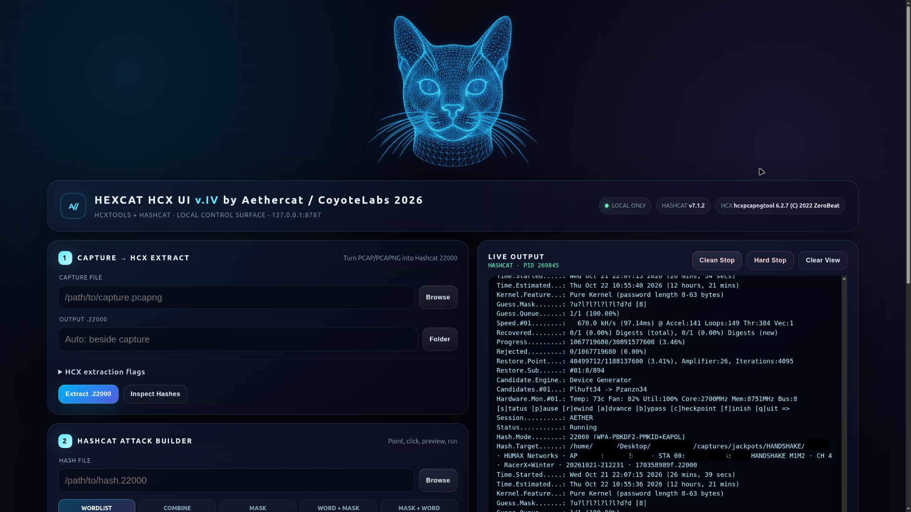

# HEXCAT

HEXCAT is a simplified local browser interface for HCXTOOLS and Hashcat to make password auditing easier, especially for beginners. Point and click, no long syntax typed strings required. It converts Wi-Fi captures to `.22000` hashes, inspects hashes, configures attacks, restores sessions, and displays live output. 

The final IV release includes five attack modes: Wordlist, Combine, Mask, Word + Mask, and Mask + Word. It supports custom `.rule` and `.hcmask` files, custom character sets, quick-mask presets, GPU/device selection, and potfile recovery.

HEXCAT LIVE STATUS displays target ESSID, AP and client MAC addresses, progress, attack stage, active wordlist, mask and rule, ETA, speed, recovered counts, candidates, and GPU temperature. Native Hashcat output remains visible alongside the status display, with terminal copying, improved scrolling, retained end-of-run output, and a dedicated recovered-password display.

**THIS IS THE FINAL VERSION OF HEXCAT IV. HEXCAT V IS COMING SOON.**

Version: IV.k — final Version IV release.

**[Download HEXCAT IV.k ZIP](https://github.com/aaronmcnees/HEXCAT/releases/download/v4.0.k/HEXCAT4-FINAL.zip)** · [Release notes](https://github.com/aaronmcnees/HEXCAT/releases/tag/v4.0.k)

**Use HEXCAT only on systems and networks you own or have explicit permission to audit. Do not use it to recover passwords or access systems without authorization.**

## Requirements

- Linux with Bash.
- Python 3; no pip packages required.
- Hashcat with a working CPU/GPU driver and compute runtime.
- HCXTOOLS: `hcxpcapngtool` and `hcxhashtool`.
- A web browser.
- Native file selection uses Zenity, KDialog, or Python's Tkinter fallback.
- Your capture or `.22000` hash file.
- **Your own wordlists:** one for Wordlist or hybrid attacks; two for Combine. **Wordlists are not bundled.**

## Start

Open a terminal inside the HEXCAT folder and enter `bash RUN.sh`.

You can also launch directly with `python3 HEXCAT4b.py`. Keep `HEXCAT4b.py`, `HEXCAT4b.html`, and `hcx.png` together in the HEXCAT folder.

The browser opens automatically. HEXCAT uses localhost, starting at port 8787. The terminal displays the actual address.

Use **Clean Stop** to stop an active job, then **Ctrl+C** in the launch terminal to close HEXCAT.

`COYOTEBLUE.rule` is an experimental rule set for quick testing. In Wordlist mode, use **Custom** to select it. See [CHANGES.md](CHANGES.md) for the full project history through IV.k. The earlier IV.a notes remain in [changelog.txt](changelog.txt).

See [MANUAL.md](MANUAL.md) for basic operation, custom rules and masks, and live-status controls.

## Thanks

Thanks to **Jens Steube (atom)**, creator of **Hashcat**, and **ZerBea**, creator of **hcxtools**, along with both projects' maintainers and contributors. Their work makes HEXCAT possible.

If you enjoyed using HEXCAT, please star this repository, thanks!
